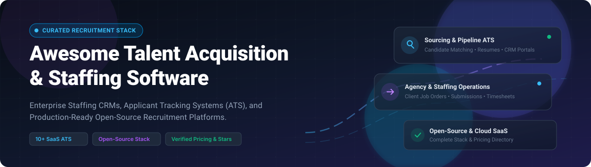

  

# 🚀 Awesome Talent Acquisition & Staffing    

> 🎯 A curated directory of top **Talent Acquisition (TA)** and **Staffing platforms** — covering commercial enterprise SaaS solutions, recruiting CRMs, applicant tracking systems (ATS), and production-ready open-source alternatives for modern recruitment agencies and talent teams. ✨

---

## 🧭 Table of Contents

- [📈 Sector Overview & Market Dynamics](#-sector-overview--market-dynamics)
- [🟦 SaaS / Hosted Platforms](#-saas--hosted-platforms)
- [🟩 Open-Source Software](#-open-source-software)
- [📊 Comparison at a Glance](#-comparison-at-a-glance)
- [🔍 SEO Keywords & Topics](#-seo-keywords--topics)
- [🤝 Contributing](#-contributing)
- [💖 Support](#-support)
- [⭐ Star History](#-star-history)
- [📄 License](#-license)

---

## 📈 Sector Overview & Market Dynamics

The global staffing and recruitment services industry commands an estimated market size exceeding **$550B–$630B+**, while the dedicated talent acquisition and recruitment software (ATS/CRM) technology market accounts for approximately **$26B–$28B+** and is projected to expand significantly with AI integration. 💼📊

The sector exhibits distinct market dynamics:
- 🏢 **Broader Staffing & Agency Services:** Highly fragmented across tens of thousands of regional, boutique, and specialized recruitment firms, where the top 10 global agencies control under 10% of overall industry volume.
- ⚡ **Talent Acquisition (TA) Software Layer:** Moderately fragmented but experiencing rapid consolidation, with enterprise human capital management (HCM) suites and scaled recruiting leaders routinely acquiring point solutions in AI sourcing, resume parsing, and candidate engagement.

---

## 🟦 SaaS / Hosted Platforms

Commercial, cloud-hosted Talent Acquisition and Staffing platforms. The table below is sorted descending by company scale (annual revenue / valuation), featuring verified entry-level pricing tiers and specific free tier or trial limits. 🌐☁️

| Product | Company Scale (Revenue / Valuation) | Starting Tier Pricing | Free Tier / Free Trial Limits | Key Features & Focus |
|:---|:---|:---|:---|:---|
| 💼 **[Zoho Recruit](https://www.zoho.com/recruit/)** | ~$1.5B Revenue (~$12.5B Valuation) | $30/recruiter/mo ($25/mo billed annually) for Standard Staffing Plan | **Free Forever Plan** (1 active job opening, basic candidate tracking); **15-Day Free Trial** for paid tiers (capped at 20 emails total per account during trial) | Sourcing, candidate management, client portal, job boards, and automated workflows natively integrated into the Zoho ecosystem. |
| 🚀 **[Vincere](https://www.vincere.io/)** *(The Access Group)* | ~$1.4B+ Revenue / ~$11B+ Parent Valuation (~$17M Vincere standalone) | £95/user/mo for Core Plan (~£150/mo flat for solo Startup Plan) | **No self-serve free trial** (Evaluation sandbox / targeted module pilot available upon sales demo) | Combined recruitment CRM and ATS ("Recruitment Operating System") built specifically for mid-market and scaling staffing agencies. |
| 🐂 **[Bullhorn](https://www.bullhorn.com/)** | ~$250M–$335M+ Revenue (Multi-billion Private Valuation) | $99/user/month (Starter tier) | **No free trial** (Guided enterprise product demonstration with custom workflows only) | Long-standing enterprise market leader for staffing firms, handling front-to-back office pipelines, submittals, and marketplace integrations. |
| 🤖 **[Ceipal ATS](https://www.ceipal.com/)** | ~$119M–$171M+ Revenue | ~$24–$25/user/month (5-user minimum commitment, ~$120–$125/mo baseline) | **No public self-serve free trial** (Consultative sandbox access provided post-demo) | AI-powered candidate matching, sourcing automation, and workforce management for contract staffing and IT recruiters. |
| 🎯 **[Loxo](https://loxo.co/)** | ~$27M–$76M+ Revenue ($115M Venture Backing) | $149/user/month billed annually (Core ATS/CRM) | **7-Day Free Trial** (Professional tier trial with 850M+ talent graph access, no credit card required) | AI recruitment engine combining ATS, multi-channel outbound CRM, sourcing automation, and enriched personal contact information. |
| 📑 **[JobDiva](https://www.jobdiva.com/)** | ~$26M–$32M+ Revenue (Bootstrapped) | ~$100/user/month (Starting baseline estimate; quote-based) | **No free trial** (Custom tailored demonstration required) | Staffing agency ATS and CRM renowned for automated resume harvesting, candidate matching, and VMS synchronization. |
| 🏭 **[Avionté](https://www.avionte.com/)** | ~$26M–$47M+ Revenue (PE-backed) | ~$100–$150+/user/month (Starting staffing ATS; quote-based) | **No free trial** (Live guided consultation and workflow demo only) | Front-to-back staffing software specializing in clerical, light industrial, and healthcare placements, including integrated payroll and billing. |
| ☁️ **[TargetRecruit](https://www.targetrecruit.com/)** *(Acquired by Bullhorn)* | ~$15M–$25M Revenue (Acquired July 2025) | $124–$150/user/month (Professional baseline tier) | **No free trial** (Sales demo required) | Enterprise ATS and CRM built natively on the Salesforce platform, engineered for healthcare and large-scale contract staffing firms. |
| 📋 **[TrackerRMS](https://www.tracker-rms.com/)** | ~$12.6M–$13.5M Revenue (Backed by GSV) | ~$79–$110/user/month (Starter/Pro baseline tiers) | **No self-serve free trial** (Demo-based trial provisioned upon consultation) | Complete recruitment agency software suite uniting sales CRM, applicant tracking, candidate onboarding, and back-office timesheets. |
| 🔄 **[Crelate](https://www.crelate.com/)** | ~$9.5M+ Revenue ($12.1M Funding) | $85/user/month billed annually (Essentials Plan, capped at 2 seats); $119/user/mo (Business) | **14-Day Free Trial** (Full Business platform access, no credit card required) | Modern recruiting CRM and ATS combining visual pipeline management, automated candidate engagement, and flexible agency workflows. |

---

## 🟩 Open-Source Software

Self-hosted, transparent, and community-driven Talent Acquisition and Applicant Tracking systems. Sorted descending by GitHub stargazers count. 🛠️💻

### 1. 🌟 [Frappe HR / HRMS](https://github.com/frappe/hrms) 
- ⚙️ **Stack:** Python / JavaScript / MariaDB / Redis (Frappe Framework)
- 📜 **License:** GPL-3.0
- 📝 **Summary:** An enterprise-grade, 100% open-source HR and recruitment management suite. It features a complete applicant tracking system with job applicant pipelines, job opening portals, interview scheduling, offer letter generation, and onboarding workflows that transition into employee management.
- 🎯 **Best For:** Modern businesses and staffing teams seeking a comprehensive, customizable, and modern open-source hiring and workforce platform.

### 2. 🦍 [Horilla HR](https://github.com/horilla/horilla-hr) 
- ⚙️ **Stack:** Python / Django / PostgreSQL
- 📜 **License:** LGPL-2.1
- 📝 **Summary:** A comprehensive human resource platform featuring a first-class recruitment module alongside employee onboarding, attendance, and leave management. Provides visual candidate pipelines, interview workflows, and a REST API with zero default credentials.
- 🎯 **Best For:** Organizations seeking a modern Python/Django architecture for candidate pipelines and end-to-end recruitment lifecycle tracking.

### 3. 🍊 [OrangeHRM](https://github.com/orangehrm/orangehrm) 
- ⚙️ **Stack:** PHP / Symfony / MySQL
- 📜 **License:** GPL-2.0
- 📝 **Summary:** One of the most widely deployed open-source human resource platforms globally, featuring a dedicated recruitment module for publishing vacancies, collecting resumes, tracking applicant statuses, and managing interview stages.
- 🎯 **Best For:** Established enterprises and public sector organizations requiring proven, multi-language recruitment and employee management.

### 4. 🐱 [OpenCATS](https://github.com/opencats/OpenCATS) 
- ⚙️ **Stack:** PHP / MySQL
- 📜 **License:** GPL-3.0
- 📝 **Summary:** The most established dedicated open-source applicant tracking system tailored specifically for recruitment agencies. Features job orders, candidate submission tracking, client company profiles, resume parsing with full-text search, and activity logs.
- 🎯 **Best For:** Independent staffing firms and headhunters looking for a 100% free, agency-focused recruitment CRM with self-hosted data ownership.

### 5. ⚡ [Nueno](https://github.com/nueno-co/nueno) 
- ⚙️ **Stack:** TypeScript / Next.js / Node.js
- 📜 **License:** AGPL-3.0
- 📝 **Summary:** A modern, lightweight open-source applicant tracking system built for engineering teams and fast-growing businesses. Features clean Kanban candidate boards, customizable recruitment stages, and seamless hiring manager collaboration.
- 🎯 **Best For:** Modern tech companies and startups looking for a snappy, TypeScript-first ATS experience.

### 6. 🌐 [Plutomi](https://github.com/plutomi/plutomi) 
- ⚙️ **Stack:** TypeScript / Node.js / Docker
- 📜 **License:** Apache-2.0
- 📝 **Summary:** A scalable multi-tenant applicant tracking system designed to streamline high-volume application intake and candidate screening with customizable stages and automated progression rules.
- 🎯 **Best For:** Developers and hiring teams needing high-throughput application management and modern architecture.

### 7. 🧙 [Hire Gnome ATS](https://github.com/Gnorman-Codes/hire-gnome-ats) 
- ⚙️ **Stack:** TypeScript / React / Node.js
- 📜 **License:** MIT
- 📝 **Summary:** A lightweight, self-hosted recruiting tool created as an open-source Bullhorn alternative for boutique agencies. Focuses on candidates, job orders, and client pipelines without enterprise complexity or overhead.
- 🎯 **Best For:** Solo recruiters and boutique agencies wanting a minimalist, self-hosted ATS for core candidate submittals.

---

## 📊 Comparison at a Glance

| Software | Model | License / Architecture | Agency-Focused | Dedicated ATS Pipeline | Self-Hosted | Primary Deployment |
|:---|:---|:---|:---:|:---:|:---:|:---|
| 💼 **Zoho Recruit** | Commercial SaaS | Proprietary Cloud | ✅ | ✅ | ❌ | Multi-tenant Cloud |
| 🚀 **Vincere** | Commercial SaaS | Proprietary Cloud | ✅ | ✅ | ❌ | Multi-tenant Cloud |
| 🐂 **Bullhorn** | Commercial SaaS | Proprietary Cloud | ✅ | ✅ | ❌ | Enterprise Cloud |
| 🤖 **Ceipal ATS** | Commercial SaaS | Proprietary Cloud | ✅ | ✅ | ❌ | Enterprise Cloud |
| 🎯 **Loxo** | Commercial SaaS | Proprietary Cloud | ✅ | ✅ | ❌ | Multi-tenant Cloud |
| 📑 **JobDiva** | Commercial SaaS | Proprietary Cloud | ✅ | ✅ | ❌ | Enterprise Cloud |
| 🏭 **Avionté** | Commercial SaaS | Proprietary Cloud | ✅ | ✅ | ❌ | Enterprise Cloud |
| ☁️ **TargetRecruit** | Commercial SaaS | Salesforce Cloud | ✅ | ✅ | ❌ | Salesforce Platform |
| 📋 **TrackerRMS** | Commercial SaaS | Proprietary Cloud | ✅ | ✅ | ❌ | Multi-tenant Cloud |
| 🔄 **Crelate** | Commercial SaaS | Proprietary Cloud | ✅ | ✅ | ❌ | Multi-tenant Cloud |
| 🌟 **Frappe HR** | Open-Source | GPL-3.0 (Python/JS) | ❌ (HR Suite) | ✅ | ✅ | Self-hosted / Frappe Cloud |
| 🦍 **Horilla HR** | Open-Source | LGPL-2.1 (Python/Django) | ❌ (HR Suite) | ✅ | ✅ | Self-hosted (Docker) |
| 🍊 **OrangeHRM** | Open-Source | GPL-2.0 (PHP/Symfony) | ❌ (HR Suite) | ✅ | ✅ | Self-hosted (LAMP) |
| 🐱 **OpenCATS** | Open-Source | GPL-3.0 (PHP/MySQL) | ✅ | ✅ | ✅ | Self-hosted (PHP/MySQL) |
| ⚡ **Nueno** | Open-Source | AGPL-3.0 (Next.js/TS) | ❌ (Internal) | ✅ | ✅ | Self-hosted (Docker/Node) |
| 🌐 **Plutomi** | Open-Source | Apache-2.0 (TypeScript) | ✅ | ✅ | ✅ | Self-hosted (Docker/Cloud) |
| 🧙 **Hire Gnome** | Open-Source | MIT (TypeScript/React) | ✅ | ✅ | ✅ | Self-hosted (Node.js) |

---

## 🔍 SEO Keywords & Topics

`applicant-tracking-system` • `ats` • `recruitment-crm` • `talent-acquisition` • `staffing-software` • `bullhorn-alternative` • `open-source-ats` • `recruiting-platform` • `candidate-pipeline` • `agency-staffing` • `headhunting-software` • `hr-tech`

---

## 🤝 Contributing

Contributions are warmly welcomed! 🌟 To suggest a new tool or update existing information:

1. 🍴 Fork this repository.
2. 🌿 Create your feature branch (`git checkout -b feature/add-new-tool`).
3. 💾 Commit your changes with clear descriptions (`git commit -m 'Add ToolName to Open-Source section'`).
4. 📤 Push to your branch (`git push origin feature/add-new-tool`).
5. 📬 Open a Pull Request.

Please ensure open-source submissions are actively maintained, include a valid OSI-approved license, and provide genuine recruiting or applicant tracking utility. ✨

---

## 💖 Support

Thank you so much for visiting and using this resource! 🙏 If you find this curated collection helpful for your hiring workflows or agency operations, please consider supporting the project:

- ⭐ **Star this repository** to help others discover it on GitHub!
- 🍴 **Fork and contribute** by submitting your favorite recruiting tools or improvements.
- 📢 **Share it** with friends, colleagues, and talent acquisition communities.
- ☕ **Buy me a coffee / Sponsor:** If you'd like to support ongoing maintenance and curation of open developer resources, consider sponsoring via the **[GitHub Sponsors Dashboard](https://github.com/sponsors/ishandutta2007)**!

---

## 🌟 Star History

---

## 📄 License

This repository is made available under the [CC0 1.0 Universal](https://creativecommons.org/publicdomain/zero/1.0/) (Public Domain Dedication). Listed software products and repositories belong to their respective copyright holders.

---

  ⭐ <b>Star this repository if you find it helpful for your talent acquisition and staffing operations!</b> ⭐

